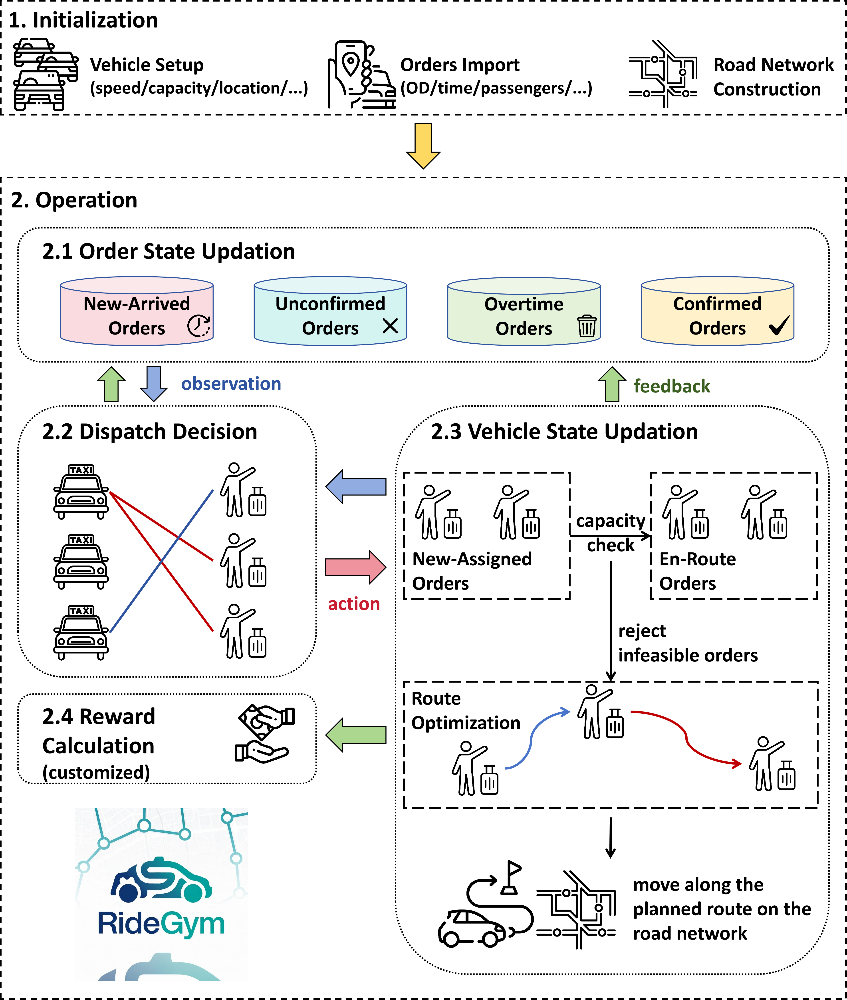

# RideGym

**Article:** Zijian Zhao, Yulong Hu, Sen Li*, "[RideGym: A Standardized Interface for Real-World Large-Scale Ride-Sharing System](https://arxiv.org/abs/2607.10173)", Proceedings of the 33rd ACM SIGKDD Conference on Knowledge Discovery and Data (KDD) 2027

[ride-gym · PyPI](https://pypi.org/project/ride-gym/) is a Gym-like (but not Gym-dependent) simulation environment for large-scale ride-pooling and order dispatching.



A fleet of vehicles serves a stream of ride requests that arrive over time, with realistic pooling, capacity limits, road-network routing, and impatient passengers. Each vehicle is an agent under a fully-centralized multi-agent setting: at every decision step you assign pending orders to vehicles, and the simulator handles conflict resolution, route re-planning, movement, and reward computation. The env is built from swappable components (order source, road network, route planner, reward), so you can plug in your own without touching the core loop.

---

## Contents

- [Part 1 — The `ride_gym` environment](#part-1--the-ride_gym-environment) &nbsp;(install & use the simulator)
  - [Optional simulation features](#optional-simulation-features)
- [Part 2 — The research benchmark](#part-2--the-research-benchmark) &nbsp;(reproduce our train / test results)
  - [Repository layout](#repository-layout)
  - [Setup](#benchmark-setup)
  - [Step A — Prepare the NYC data](#step-a--prepare-the-nyc-data)
  - [Step B — Train the RL dispatch agents](#step-b--train-the-rl-dispatch-agents)
  - [Step C — Test & compare on held-out windows](#step-c--test--compare-on-held-out-windows)

---

# Part 1 — The `ride_gym` environment

The simulator is published on PyPI and can be used entirely on its own (no benchmark code required). The wheel and source distribution contain the `ride_gym` package; benchmark and training code remain in this repository. See [the package guide](README_PYPI.md) for the standalone simulator documentation.

## Installation

```bash
pip install ride-gym
```

The core only needs `numpy`. Install extras as needed:

```bash
pip install 'ride-gym[data]'     # pandas/pyarrow/geopandas/osmnx: build & preprocess real demand
pip install 'ride-gym[osmnx]'    # real OpenStreetMap road networks
pip install 'ride-gym[viz]'      # matplotlib: rendering & animation
pip install 'ride-gym[all]'      # everything
```

Requires Python >= 3.9.

## Quickstart

```python
from ride_gym import RidePoolEnv
from ride_gym.order_generator import RandomOrderGenerator
from ride_gym.road_network import ManhattanNetwork

# 1. Demand: your own trips, or a procedural generator.
order_gen = RandomOrderGenerator(
    area=(0.0, 0.0, 10.0, 10.0), horizon=60.0, num_orders=10000,
    arrival="poisson", max_party_size=3,
)

# 2. Road network: abstract backend, or a real OSM graph (see below).
network = ManhattanNetwork(speed=1.0)   # coordinate units per minute

# 3. Environment.
env = RidePoolEnv(
    num_drivers=1000,
    driver_capacity=4,
    dt=1.0, horizon=60.0,
    order_timeout=3.0,          # orders waiting longer than this are withdrawn
    order_generator=order_gen,
    road_network=network,
)

# 4. Roll out. obs / rewards are dicts keyed by vehicle id.
obs, info = env.reset(seed=0)
done = False
while not done:
    actions = {}
    for i, s_v in obs.items():
        pool = s_v["pending_orders"]        # orders waiting to be assigned
        order_ids = my_policy(s_v, pool)    # -> list of order ids to bid on
        actions[i] = {"orders": order_ids}  # empty list = take no order
    obs, rewards, dones, info = env.step(actions)
    done = dones["__all__"]
```

Drop your training code straight into the loop between `step` calls.

## Actions

Each vehicle's action is a small dict (the two keys are mutually exclusive):

```python
{"orders": [order_id, ...]}    # bid on pending orders (empty = take no order)
{"relocate": index_or_coord}   # idle vehicles only: reposition to a point
```

The simulator automatically enforces feasibility every step: an order goes to at most one vehicle, and a vehicle never exceeds its remaining capacity. If two vehicles bid on the same order the env raises a `ConflictError` — the upstream (central) policy must coordinate to avoid conflicts.

## Order sources

Bring your own historical trips as a table (one row per order):

```python
from ride_gym.order_generator import DataFrameOrderGenerator

# Columns: origin_x, origin_y, dest_x, dest_y, request_time, num_passengers
order_gen = DataFrameOrderGenerator(dataframe=my_orders_df)
```

or use `RandomOrderGenerator` for synthetic demand with `uniform` / `poisson` / `peak` arrivals. For the real NYC scenario ([TLC Trip Record Data - TLC](https://www.nyc.gov/site/tlc/about/tlc-trip-record-data.page)) there are also `NYCOrderGenerator` (single window) and `MultiWindowNYCOrderGenerator` (train/val/test window pools).

## Road networks

For abstract experiments, use the fast closed-form `EuclideanNetwork` or `ManhattanNetwork`. For real maps, `OSMnxNetwork` loads an OpenStreetMap graph whose all-pairs shortest paths are precomputed and cached to disk, so every distance query is an `O(1)` lookup:

```python
from ride_gym.osmnx_network import OSMnxNetwork
network = OSMnxNetwork(graph_path="data/manhattan.gpickle")
```

When a vehicle is part-way along a directed road edge, it finishes that edge before following a newly planned route. Route predictions use the same state: the remaining distance to the edge endpoint, followed by the route from that endpoint. They do not snap the vehicle's interpolated position back onto a node.

## Custom route planners

Subclass `RoutesPlanner` and implement `plan(start, task_points, network)`. Return every supplied stop exactly once, with each pickup before its drop-off; a drop-off without a pickup represents an order already onboard. The inherited `plan_with_times()` calls `plan()` and computes cumulative travel times, so implementing `plan()` alone is sufficient. An optimized planner may override `plan_with_times()` to return `(ordered_stops, arrival_times)`, where `arrival_times` is `{order_id: {"pickup": minutes, "dropoff": minutes}}` relative to the planning start.

For a vehicle mid-edge, the planning start is the current edge's endpoint; the environment adds the remaining edge travel time. Assignment routes and time estimates are prepared and validated before the assignment batch is committed, so a planning failure does not leave that batch partially assigned.

## Custom rewards

A `DefaultRewardFunction` modelling platform revenue and passenger satisfaction is provided. To optimize for your own criteria (waiting time, service rate, detour, ...), subclass `RewardFunction` and pass it to the env:

```python
from ride_gym import RidePoolEnv, DefaultRewardFunction
env = RidePoolEnv(..., reward_function=DefaultRewardFunction(assignment_bonus=1.0))
```

Predicted route times, direct-trip baselines and detour attribution use the vehicle's effective speed: its configured speed, or the network default when omitted. The default reward also uses direct-trip time as a revenue proxy, so vehicle speed affects that term. Correcting this time basis changes reward and ETA values for heterogeneous-speed fleets compared with versions that used the network speed for prediction.

## Centralized view

For single-agent / global-optimization research, wrap the env so one policy emits all actions and gets an aggregated reward (the per-vehicle rewards are kept in `info`):

```python
from ride_gym import CentralizedWrapper
env = CentralizedWrapper(RidePoolEnv(...), aggregate="sum")
obs, reward, done, info = env.step(joint_action)
```

## Visualization

With the `[viz]` extra you can render a single frame or animate a whole episode:

```python
from ride_gym.visualize import TrajectoryRecorder, render_animation

env.render(mode="human", save_path="frame.png")   # one static frame

rec = TrajectoryRecorder()
obs, _ = env.reset(seed=0)
done = False
while not done:
    obs, rewards, dones, info = env.step(my_policy(obs))
    rec.snapshot(env)
    done = dones["__all__"]
render_animation(rec, out_path="episode.gif")     # or .mp4
```

Each vehicle is drawn in its own color, with its current location, planned route along the road network, and the origins/destinations of the orders it is serving. Aggregate plots (demand & service heatmaps, supply-demand gaps, load time series, waiting-time distributions) are also available via `ride_gym.analysis`.

## Optional simulation features

The extensions below are available in `ride-gym` version 0.2.0 and later; install them with `pip install --upgrade ride-gym`, or install this source tree with `pip install .`. They are opt-in. Existing constructor arguments, actions, return values and default observation fields remain compatible. Omitting the new options preserves the original immediate-assignment behavior and seeded random sequence. Acceptance and response timing use separate random streams.

All simulation times are **minutes from episode start**, except response-policy durations, which are explicitly **seconds**. Coordinates and speeds follow the selected network: speed is in network distance units per minute. A `vehicle_type` is a user-defined label; it does not silently select a calibrated speed or capacity.

### Statistics granularity

`statistics_granularity="decision"` is the default and preserves the original reporting convention: pickup and drop-off timestamps are recorded at the start of the decision step in which the event occurs. For distance accounting, the entire step is classified using occupancy at the start of that step.

Use continuous reporting to record arrival and service-completion times within a step and accumulate empty and occupied distance per traveled segment:

```python
env = RidePoolEnv(
    num_drivers=10,
    dt=1.0,
    statistics_granularity="continuous",
)
```

In continuous mode, each driver's event dict also contains `empty_distance_moved` and `occupied_distance_moved`; their sum equals `distance_moved`. The benchmark recorder uses these fields when present and falls back to the original step-level classification for decision-mode or older events. For example, a step traveling 0.25 distance units before pickup and 0.5 after pickup reports empty distance 0.25 and occupied distance 0.5 in continuous mode, instead of classifying the entire 0.75 as empty.

This option controls reporting only. For the same actions, it does not change decision frequency, physical movement, readiness or service waits, assignment, random draws, ETA, or the built-in reward. In both modes, `is_empty_move` retains its original meaning: the vehicle started the step empty and moved during that step. The default empty-move penalty is applied once when that flag is true; a custom reward can use continuous distance fields for finer accounting. Snapshot restoration requires the same statistics granularity.

### Vehicle settings and online intervals

For capacity and speed alone, use the existing `driver_capacities` and `driver_speeds` lists, each of length `num_drivers`. To also specify initial positions, service times or availability, supply an explicit fleet:

```python
from ride_gym.labor_source import ExplicitLaborSource, ShiftWindow

fleet = ExplicitLaborSource([
    {
        "location": (0.0, 0.0), "vehicle_type": "bicycle",
        "capacity": 2, "speed": 0.8,
        "pickup_service_time": 0.25, "dropoff_service_time": 0.15,
        "availability_windows": [
            ShiftWindow(0.0, 5.0),
            ShiftWindow(7.0, 10.0, location=(0.5, 0.5)),
        ],
    },
    {
        "x": 4.0, "y": 1.0, "vehicle_type": "car",
        "capacity": 3, "speed": 1.2,
        "shift_start": 1.0, "shift_end": 10.0,
    },
])
env = RidePoolEnv(num_drivers=2, labor_source=fleet, horizon=10.0)
```

Driver IDs are the row indices `0..num_drivers-1`. Fleet size must match `num_drivers`. Use either one `shift_start` / `shift_end` interval or several `availability_windows` for a driver. Intervals are `[start, end)` and cannot overlap. An omitted schedule means always online. `ExplicitLaborSource` uses `WindowShiftPolicy` by default; a custom `ShiftPolicy` can be supplied through `shift_policy=`.

At shift end, a vehicle stops receiving new offers and finishes existing commitments before departing. An invitation already awaiting a reply is also retained. Offline vehicles remain in the observation and reward dictionaries, so the agent set stays fixed. Dispatch policies can check `obs[driver_id]["self"]["available"]`; the environment also blocks new bids from unavailable vehicles. A new interval's entry position is applied only when the vehicle has no commitments, never while it is serving an order. Graph networks snap supplied positions onto nodes.

`CsvLaborSource("fleet.csv")` accepts the same fleet fields in a UTF-8 CSV, one row per vehicle. Use `x,y` or `lon,lat` columns for coordinates; blank optional cells inherit defaults. A CSV `availability_windows` cell may contain a JSON array of `{ "start": ..., "end": ..., "location": [x, y] }` objects. All stop-service durations default to zero.

### Readiness and order files

`Order(..., ready_time=3.0)` makes a pickup unavailable before minute 3. The order can be assigned earlier, but a vehicle arriving early waits at the pickup. A readiness time before the request or episode start means the order is already ready. Optional pickup service begins after readiness; optional drop-off service consumes time before completion. These constraints work on both abstract and graph networks. Omitting `ready_time` preserves the original pickup behavior. Acceptance-policy route times describe travel only; readiness is not included in those contexts.

For DataFrame input, opt in explicitly with `DataFrameOrderGenerator(dataframe=df, columns={"ready_time": "ready_time"})`. Without that mapping, existing DataFrame inputs continue to ignore additional readiness columns. For a plain CSV without pandas:

```python
from ride_gym.order_generator import CsvOrderGenerator

order_gen = CsvOrderGenerator("orders.csv")
# Required columns: origin_x, origin_y, dest_x, dest_y, request_time
# Optional columns: order_id, num_passengers, ready_time
```

CSV times default to relative minutes. For timezone-aware ISO timestamps, pass an explicit origin, for example `time_origin="2030-01-01T09:00:00+00:00"`; request and readiness timestamps are converted to minutes relative to that origin. `columns={...}` maps canonical field names to your column names. There is no implicit epoch-unit or speed-unit conversion. Each reset creates fresh order objects.

Set `validate_order_coords=True` to receive an episode-level warning when order endpoints fall outside `area`. Validation warnings are disabled by default.

### Road-network guards

Dense all-pairs routing uses approximately `12 * num_nodes**2` bytes for its distance and predecessor arrays, excluding the graph, temporary build memory and cache-loading copies. To impose a limit explicitly, pass `OSMnxNetwork(..., max_matrix_bytes=512 * 1024**2)`. Leaving it as `None` preserves unrestricted loading. `ride_gym.region.NodeBudget` exposes the same check before constructing a network.

For geographic inputs, `check_coverage(network, points, max_snap_km=1.0)` measures the share of longitude/latitude points within the chosen great-circle distance of a road node; `require_coverage(report, min_share=0.95)` rejects a poor match explicitly. These helpers do not download a graph. `bbox_of_points` uses the input coordinate units, while `bbox_center_radius` requires geographic bounds and returns `(center_lat, center_lon, radius_metres)`. Install the optional graph dependencies with `pip install '.[osmnx]'`.

### Acceptance probabilities and response times

```python
from ride_gym.acceptance import AcceptanceProbabilities, PerDriverAcceptancePolicy
from ride_gym.response import FixedResponseTimePolicy

acceptance = PerDriverAcceptancePolicy(
    profiles={
        0: AcceptanceProbabilities(general=0.85, single=0.9, bundle=0.75),
        1: AcceptanceProbabilities(general=0.95),
    },
    default=AcceptanceProbabilities(general=1.0),
)
env = RidePoolEnv(
    num_drivers=2,
    acceptance_policy=acceptance,
    acceptance_seed=11,
    response_time_policy=FixedResponseTimePolicy(seconds=12.0),
    response_seed=23,
    dt=0.25,
)
```

A `single` offer contains one **new** order, even when the vehicle already has other work; a `bundle` contains two or more new orders. Type-specific probabilities override `general`. The environment applies its capacity rule and validates the proposed route before sampling once for the resulting invitation. Acceptance or rejection applies to that whole invitation. Rejected orders keep their original request time and remain pending; assignment rewards are emitted only when an order is actually assigned.

With `response_time_policy=None`, a successful offer is assigned immediately. When a timing policy is supplied, the reply becomes effective at the **strictly next global decision boundary after the response time**. For example, with `dt=0.25`, an offer at minute 0 with a 12-second response becomes effective at minute 0.25; a response exactly at minute 0.25 becomes effective at minute 0.5. Even `FixedResponseTimePolicy(0)` waits for the next boundary.

While awaiting a reply, a vehicle continues its existing route. The invitation's orders are reserved and hidden from other vehicles' pending pool, and that vehicle cannot receive another offer. At resolution the environment rechecks the whole invitation; cancelled orders or insufficient capacity invalidate it without a partial commit. Accepted offers enter the route before the following dispatch decision. Reservations end on rejection or invalidation.

Other built-ins are `UniformResponseTimePolicy(max_seconds=60)` and `BetaResponseTimePolicy(alpha=2, beta=1, max_seconds=60)`. A custom acceptance policy implements `probability(context)`; a custom response policy implements `sample_seconds(context, rng)`. Contexts are immutable snapshots of the vehicle, new orders and proposed travel route. Use the supplied RNG for response sampling. `configuration()` is required for snapshot identity; a stateful behavior policy must also implement `state_dict()` and `load_state_dict()`.

### Snapshots and pre-rolls

Warm-up is an ordinary prefix of the same episode. It advances the clock and vehicles without an implicit reset or a separate reward/evaluation filter:

```python
from ride_gym.warmup import warmup, save_snapshot, load_snapshot

obs, _ = env.reset(seed=7)
obs, info, state = warmup(env, my_policy, steps=4)
# Continue with env.step(...), or save this state explicitly:
save_snapshot("snapshot.json", state)

# Restore into an already-reset environment with the same configuration:
env.apply_initial_state(load_snapshot("snapshot.json"))
# Alternatively pass initial_state=state when constructing the matching env.
```

`env.capture_initial_state()` captures the simulator clock, all current-episode orders, vehicle routes and graph-edge progress, service waits, simulator RNGs and pending invitations. Snapshots use JSON rather than pickle. Restore validates compatibility and keeps the saved clock. An external dispatcher's state, arbitrary planner/reward/shift-policy state, and an order generator's state for future resets must be saved separately by the application. Custom network and shift-policy configuration should expose `configuration()` so snapshots can verify it.

The runnable [optional-features example](examples/optional_features.py) combines these options using only synthetic demand and numpy. From the repository root:

```bash
python -m examples.optional_features
python -m unittest discover -s tests -v
```

The example does not download data or create output files.

---

# Part 2 — The research benchmark

This repository also contains the full **benchmark** we use to study learning-based order dispatching on a real New York City ride-pooling scenario. It provides:

- **Three RL dispatch agents** — `iddqn` (Independent Double DQN with bipartite matching, supporting the MLP/Assignment-Net/CV-Net), `mfddqn` (Mean-Field DDQN), and `bmgq` (BMG-Q, a graph-attention mean-field variant).
- **Model-based baselines** — `random_radius`, `gale_shapley`, `nearest_distance`, `hungarian`.
- **A fair evaluation harness** — every method runs through the same seeded episodes on the same held-out NYC test windows, so KPI differences reflect only the dispatch policy.

> This repository bundles the `ride_gym/` environment source together with the benchmark code (`benchmark/`, `iddqn/`, `mfddqn/`, `bmgq/`), so the benchmark runs entirely from a clone with no separate install of the environment required. (The standalone `ride_gym` package is also published on PyPI for use outside this benchmark.)

## Repository layout

```
ride_gym/            # the simulation environment (the pip package)
  data_tools/        #   NYC data-preparation CODE (no bundled data)
benchmark/           # evaluation harness: config, runner, baselines, run_test
iddqn/               # IDDQN agent + trainer
mfddqn/              # Mean-Field DDQN agent + trainer
bmgq/                # BMG-Q agent + trainer
data/                # generated data lands here (git-ignored, not shipped)
dataset/             # raw inputs you download (FHVHV parquet, taxi zones)
```

## Step A — Prepare the NYC data

The scenario is built from public NYC TLC data. Download two raw inputs into `./dataset/`:

1. **High-Volume FHV trip records** (one month, parquet) from the
   [NYC TLC Trip Record Data](https://www.nyc.gov/site/tlc/about/tlc-trip-record-data.page) page, saved as
   `./dataset/fhvhv_tripdata_2026-04.parquet` (any month works — adjust the dates in `build_splits.py`).
2. **Taxi Zone shapefile** from the same page, extracted to
   `./dataset/taxi_zones/taxi_zones.shp`.

Then build the derived assets with the `ride_gym.data_tools` command-line tools (they all write under `./data/`):

```bash
# 1. Reduce taxi-zone polygons to (lon, lat) centroids  ->  data/nyc/zone_centroids.csv
python -m ride_gym.data_tools.nyc.zone_centroids

# 2. Download & cache the Manhattan region-A road network  ->  data/nyc/manhattan.gpickle
python -m ride_gym.data_tools.nyc.build_nyc_network

# 3. (optional) Preprocess ONE order window  ->  data/nyc/orders.parquet
python -m ride_gym.data_tools.nyc.preprocess_orders

# 4. Slice raw trips into train/val/test window files + manifest  ->  data/nyc/splits/
python -m ride_gym.data_tools.nyc.build_splits            # 60-min windows (default)
```

After step 4 you should have:

```
data/nyc/manhattan.gpickle
data/nyc/zone_centroids.csv
data/nyc/splits/manifest.json
data/nyc/splits/train/window_XXXX.parquet
data/nyc/splits/val/window_XXXX.parquet
data/nyc/splits/test/window_XXXX.parquet
```

The train / val / test windows come from **disjoint day ranges**, so there is no temporal leakage. Edit `TRAIN_DAYS` / `VAL_DAYS` / `TEST_DAYS` and `DAILY_WINDOW_STARTS` at the top of `ride_gym/data_tools/nyc/build_splits.py` to match your data month and desired coverage.

## Step B — Train the RL dispatch agents

Each agent has its own trainer. Hyper-parameters and the scenario (drivers, horizon, splits, ...) live in that trainer's `TrainConfig`; run it as a module to train with the defaults:

```bash
python -m iddqn.train_iddqn      # IDDQN
python -m mfddqn.train_mfddqn    # Mean-Field DDQN
python -m bmgq.train_bmgq        # BMG-Q
```

Each run creates a timestamped directory `<algo>/runs/<algo>_YYYYmmdd_HHMMSS/` containing:

- `config.json` — the exact config used;
- `checkpoints/<algo>_ep<N>.pt` — periodic model checkpoints;
- `train_log.csv` / `eval_log.csv` — training and validation curves;
- `eval_details/` — per-episode KPI dumps.

Training periodically evaluates on the **val** split and, at the end, on the held-out **test** split, printing a KPI table against the `nearest` / `hungarian` baselines.

**Customizing a run.** The trainers are driven by a Python config, not CLI flags. Either edit the defaults in e.g. `iddqn/train_iddqn.py::TrainConfig`, or drive it programmatically:

```python
import dataclasses
from iddqn.train_iddqn import train, TrainConfig
from benchmark.config import BenchmarkConfig

cfg = TrainConfig(
    num_episodes=500,
    benchmark=dataclasses.replace(BenchmarkConfig(), num_drivers=1000, horizon=60.0),
)
train(cfg)                    # runs the full training loop
```

## Step C — Test & compare on held-out windows

Use `benchmark.run_test` to evaluate any mix of model-based baselines and trained RL checkpoints on **specific** held-out NYC test windows. Every method runs through the same seeded episode on each window, so the comparison is apples-to-apples.

**Model-based baselines only:**

```bash
python -m benchmark.run_test \
    --seed 42 \
    --baselines nearest_distance hungarian gale_shapley random_radius \
    --windows 2 10 \
    --splits-dir data/nyc/splits/test
```

**Compare several trained RL checkpoints** (each is auto-named from its filename; the RL family — iddqn/mfddqn/bmgq — is inferred from the name):

```bash
python -m benchmark.run_test \
    --seed 42 \
    --rl-ckpt iddqn/runs/<run>/checkpoints/iddqn_ep500.pt \
    --rl-ckpt mfddqn/runs/<run>/checkpoints/mfddqn_ep500.pt \
    --rl-ckpt bmgq/runs/<run>/checkpoints/bmgq_ep500.pt \
    --windows 2 10
```

Give a checkpoint an explicit display name with `--rl NAME CKPT` (repeatable), and dump per-method detailed records with `--out-dir results/test`. Run `python -m benchmark.run_test --help` for all options.

# Citation

```
@misc{zhao2026ridegym,
      title={RideGym: A Standardized Interface for Real-World Large-Scale Ride-Sharing System}, 
      author={Zijian Zhao and Yulong Hu and Sen Li},
      year={2026},
      eprint={2607.10173},
      archivePrefix={arXiv},
      primaryClass={cs.MA},
      url={https://arxiv.org/abs/2607.10173}, 
}
```

